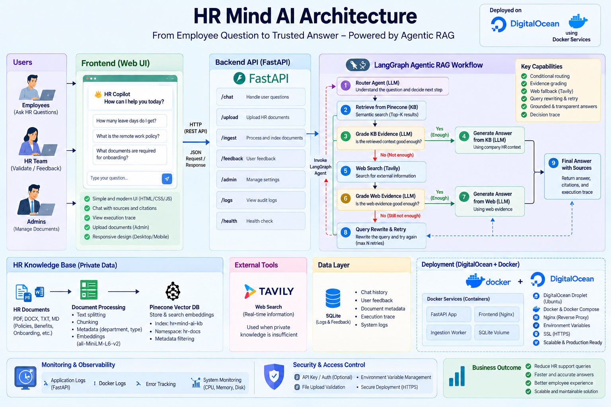
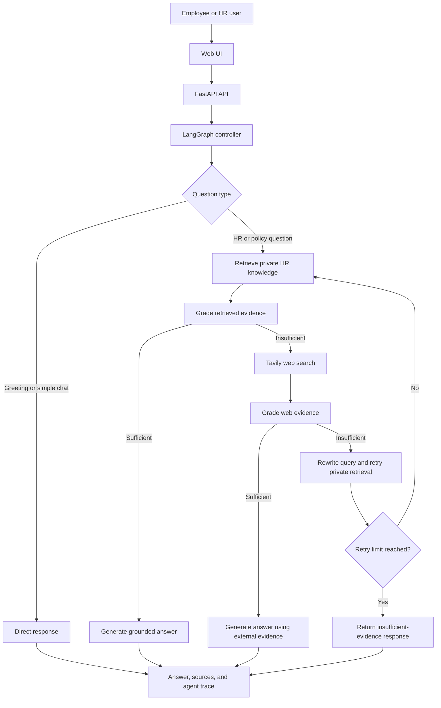

# HR Mind AI

**An Agentic RAG HR knowledge copilot for answering employee questions using trusted internal HR documents first, with web search as a fallback when private evidence is insufficient.**

[](https://hrmindai.dpdns.org/)
[](https://www.python.org/)
[](https://fastapi.tiangolo.com/)
[](https://www.docker.com/)

## Live Links

- **Application:** https://hrmindai.dpdns.org/
- **Product overview:** https://hrmindai.dpdns.org/home
- **Privacy policy:** https://hrmindai.dpdns.org/privacy
- **Terms of service:** https://hrmindai.dpdns.org/terms
- **Repository:** https://github.com/AshutoshShrivastava28/HR-Mind-AI

HR Mind AI is deployed on a DigitalOcean Droplet using Docker. Caddy terminates HTTPS and routes requests to the application container.

> **Demo note:** HR Mind AI is a portfolio project. AI-generated information can be incomplete or inaccurate. Verify important policy information against the original document and an authorised HR representative. Do not upload confidential employee records or sensitive company information unless you have permission and have confirmed that the service is approved for that use.

---

## Overview

HR teams often maintain leave policies, remote-work rules, benefits information, payroll guidance, onboarding materials, conduct policies, and operational runbooks across multiple documents. Employees may not know where the right policy is located, while a generic chatbot may produce answers that are not supported by company policy.

HR Mind AI provides a conversational interface over a configurable HR knowledge base. It retrieves relevant private documents, evaluates the evidence, and uses the configured web-search fallback only when the internal evidence is insufficient. Its workflow exposes the major routing and retrieval decisions to support debugging and demonstrations.

### Example questions

- “How many annual leave days do employees receive?”
- “How many days per week can I work remotely?”
- “What are the latest public holiday rules in Italy?”

When an answer is available in the internal knowledge base, the system should answer from that knowledge without using web search. Questions requiring current public information can follow the web fallback path, and externally sourced information should be checked before being applied as company policy.

## Key Features

### Agentic RAG

- **Private knowledge first:** retrieve relevant HR material from Pinecone before considering external search.
- **Evidence grading:** evaluate whether retrieved passages sufficiently support an answer.
- **Conditional routing:** use LangGraph to coordinate retrieval, grading, web fallback, query rewriting, and answer generation.
- **Web fallback:** use Tavily when private evidence is weak or insufficient.
- **Query rewriting and retries:** reformulate weak or ambiguous queries and retry retrieval within the configured limit.
- **Grounded responses:** return an insufficient-evidence response rather than inventing a company policy when evidence remains inadequate.
- **Sources and agent trace:** expose relevant sources and workflow decisions in the interface for transparency and debugging.

### Accounts and email workflows

- Account registration and sign-in.
- Email verification, including a resend-verification flow.
- Forgot-password and password-reset flow.
- Password-reset success returns the user to the sign-in form.
- Authentication endpoints include rate limiting and require HTTPS for non-local requests.
- Gmail API delivery over HTTPS for transactional messages such as verification and password-reset emails. SMTP remains available as a fallback when configured.
- Guest mode for public-web questions; guest conversations are not saved to signed-in account history.

### Knowledge and document management

- Upload HR knowledge documents in supported formats including PDF, TXT, Markdown, and DOCX.
- Extract text, split it into chunks, create embeddings using FastEmbed, and store searchable vectors in Pinecone.
- Use uploaded material as the source for private-knowledge retrieval.
- Support account and document administration according to the application's configured permissions.

### Application and operations

- FastAPI backend with a JavaScript, HTML, and CSS frontend.
- SQLite-backed application data and audit records.
- Docker container deployment on DigitalOcean.
- HTTPS domain, public product overview, privacy policy, and terms of service.
- Persistent server mounts for application data and uploaded files.

---

## Architecture



### Request and retrieval flow



### Deployment flow

```text
Browser
  |
  | HTTPS
  v
Caddy reverse proxy / TLS
  |
  v
HR Mind AI Docker container
  |
  +--> FastAPI and LangGraph
  +--> Groq language model
  +--> Pinecone vector database
  +--> Tavily web search (fallback)
  +--> Persistent application data and uploads
  +--> Gmail API over HTTPS (transactional email)
```

## Technology Stack

| Layer                 | Technology                                   | Role                                                          |
| --------------------- | -------------------------------------------- | ------------------------------------------------------------- |
| Agent orchestration   | LangGraph                                    | Stateful workflow, conditional routing, retries               |
| LLM                   | Groq (`openai/gpt-oss-120b`)                 | Routing, evidence grading, query rewriting, answer generation |
| Embeddings            | FastEmbed (`all-MiniLM-L6-v2`)               | Local text embedding generation                               |
| Vector database       | Pinecone                                     | Searchable HR knowledge base                                  |
| Web search            | Tavily                                       | External fallback when private evidence is insufficient       |
| Backend               | FastAPI, Python                              | HTTP API and application logic                                |
| Frontend              | HTML, CSS, JavaScript                        | Employee-facing interface and auth flows                      |
| Application data      | SQLite                                       | Account-related and application records, including audit data |
| Email                 | Gmail API over HTTPS; optional SMTP fallback | Verification and password-reset messages                      |
| Packaging             | Docker                                       | Containerized runtime                                         |
| Reverse proxy / HTTPS | Caddy                                        | TLS and routing to the application                            |
| Hosting               | DigitalOcean Droplet                         | Live deployment                                               |

---

## Repository Structure

```text
HR-Mind-AI/
├── app/
│   ├── api/
│   │   ├── routes.py             # Main application API routes
│   │   └── auth_routes.py        # Registration, login, verification, reset flows
│   ├── core/
│   │   ├── config.py             # Application settings
│   │   └── logging.py            # Logging configuration
│   ├── rag/
│   │   ├── state.py              # Agent state
│   │   ├── vectorstore.py        # Pinecone and retrieval integration
│   │   └── workflow.py           # LangGraph workflow
│   ├── services/
│   │   ├── authentication.py     # Authentication and session helpers
│   │   ├── audit.py              # Audit logging
│   │   ├── email_sender.py       # Gmail API / SMTP email delivery
│   │   ├── ingestion.py          # Document ingestion
│   │   └── rate_limiter.py       # Request rate limiting
│   └── main.py                   # FastAPI application entry point
├── data/
│   └── sample_kb/                 # Sample HR knowledge material
├── docs/
│   └── Architecture.png
├── static/
│   ├── css/
│   │   └── style.css
│   └── js/
│       ├── app.js                 # Chat and RAG interface
│       └── auth.js                # Sign-in, registration, and reset UI
├── templates/
│   └── index.html
├── tests/
├── uploads/
├── Dockerfile
├── requirements.txt
├── ingest_sample_kb.py
├── run.py
└── README.md
```

---

## Local Development

### Prerequisites

- Python 3.12
- Access to configured Groq, Pinecone, and Tavily services
- Docker Desktop, if running the containerized version

### 1. Clone the repository

```bash
git clone https://github.com/AshutoshShrivastava28/HR-Mind-AI.git
cd HR-Mind-AI
```

### 2. Create and activate a virtual environment

**Windows PowerShell**

```powershell
python -m venv .venv
.\.venv\Scripts\Activate.ps1
```

**macOS / Linux**

```bash
python3 -m venv .venv
source .venv/bin/activate
```

### 3. Install dependencies

```bash
python -m pip install --upgrade pip
python -m pip install -r requirements.txt
```

### 4. Configure environment variables

Create a local `.env` file in the repository root. Do not commit it. Set real values for the required provider keys and use a unique secret for administrative access.

```env
# AI and retrieval providers
GROQ_API_KEY=replace_with_your_groq_api_key
TAVILY_API_KEY=replace_with_your_tavily_api_key
PINECONE_API_KEY=replace_with_your_pinecone_api_key
PINECONE_INDEX_NAME=fde-hr-policy-rag
PINECONE_NAMESPACE=company-hr-kb
EMBEDDING_MODEL=all-minilm-l6-v2
TOP_K=4
MAX_RETRIES=1

# Application and authentication
APP_ENV=development
ADMIN_EMAIL=your_admin_email@example.com
ADMIN_API_KEY=replace_with_a_long_random_secret
PUBLIC_BASE_URL=http://127.0.0.1:8000

# Optional SMTP fallback for local email delivery
SMTP_HOST=
SMTP_PORT=587
SMTP_USERNAME=
SMTP_PASSWORD=
SMTP_FROM_EMAIL=
SMTP_USE_TLS=true
```

Configuration is loaded through `app/core/config.py`. If you use a different Pinecone index, namespace, or embedding model, configure these values to match your actual vector index and ingestion settings.

For local development, email can use the SMTP fallback when configured. The live deployment's Gmail API credentials are kept separately on the server and must **not** be copied into the repository or included in a Docker image.

### 5. Load the sample knowledge base (optional)

After configuring Pinecone and the required API keys, ingest the sample HR knowledge:

```bash
python ingest_sample_kb.py
```

Run this only when you intend to populate or update the configured index and namespace.

### 6. Start the application

```bash
python run.py
```

Open the local app at http://127.0.0.1:8000. If the FastAPI interactive documentation is enabled, it is available at http://127.0.0.1:8000/docs.

---

## Docker

### Build the image

```bash
docker build -t hr-mind-ai:local .
```

### Run locally

Make sure the `.env` file has been created and configured first.

```bash
docker run -d \
  --name hr-mind-ai-local \
  --restart unless-stopped \
  -p 8000:10000 \
  --env-file .env \
  -v hr-mind-ai-local-data:/app/data \
  -v hr-mind-ai-local-uploads:/app/uploads \
  hr-mind-ai:local
```

Then open http://127.0.0.1:8000.

The FastAPI process listens on container port `10000`. The command above publishes it on local port `8000`. Named volumes preserve the container's `/app/data` and `/app/uploads` directories across container recreation.

To inspect logs:

```bash
docker logs -f hr-mind-ai-local
```

To stop the local container:

```bash
docker stop hr-mind-ai-local
```

---

## Production Deployment

The live application is hosted on a DigitalOcean Droplet. Caddy handles HTTPS for `hrmindai.dpdns.org` and reverse-proxies requests to the application container. The application container listens internally on port `10000`; the production setup keeps the backend behind the reverse proxy rather than relying on the old direct IP-based HTTP link.

### Persistent data

The live deployment uses persistent server storage for application data and uploaded documents. Its Gmail OAuth credential file is stored separately on the server and mounted into the container at `/app/data/gmail_oauth.json`.

When updating or recreating a production container:

1. Build the image from the reviewed and committed repository source.
2. Preserve the existing runtime environment and persistent data mounts.
3. Keep the Gmail OAuth credential file outside the Git repository and Docker build context.
4. Validate the image and application health before replacing the running container.
5. Confirm login, registration, email verification, password reset, document retrieval, and chat after deployment.

A `git push` by itself does not update the running DigitalOcean container unless an automated deployment pipeline has been configured. The production container must be deliberately updated from a reviewed image/source release.

---

## Gmail API Configuration and Secret Handling

The deployed application uses the Gmail API over HTTPS to send transactional messages, avoiding a dependency on direct outbound SMTP connectivity. The existing SMTP implementation remains available as a fallback when its settings are configured.

The server-side Gmail credential file has the following structure:

```json
{
  "client_id": "YOUR_OAUTH_CLIENT_ID",
  "client_secret": "YOUR_OAUTH_CLIENT_SECRET",
  "refresh_token": "YOUR_REFRESH_TOKEN",
  "sender_email": "your_authorized_sender@example.com"
}
```

This example shows the expected **field names only**. Never commit real credentials, refresh tokens, API keys, passwords, or `.env` files. In the production deployment, restrict file permissions on the credential file and keep it on persistent server storage outside version control and Docker build context.

The Gmail integration is intended for sending verification and password-reset messages using the `gmail.send` permission. Refresh tokens can still be revoked or invalidated, so monitor email delivery and be prepared to reauthorize the account if needed.

---

## Demo Scenarios

### 1. Answer from private HR knowledge

**Question:** “How many annual leave days do employees receive?”

Expected workflow when the policy exists in the knowledge base:

```text
Route question → Retrieve private HR knowledge → Grade evidence
→ Generate grounded answer from the internal source
```

Tavily should not be needed when the private evidence is sufficient.

### 2. Ask a policy question

**Question:** “How many days per week can I work remotely?”

Expected behavior: retrieve the relevant remote-work policy, evaluate its evidence, and answer from the private knowledge base when possible.

### 3. Ask about current public information

**Question:** “What are the latest public holiday rules in Italy?”

Expected workflow when the private HR knowledge base does not contain sufficient evidence:

```text
Private retrieval → Weak evidence → Tavily search → Grade web evidence
→ Answer with external information, or return insufficient evidence
```

External information should be validated before it is treated as company policy.

### 4. Test authentication and email

- Register a new account and receive a verification email.
- Verify the email and sign in.
- Request a password reset, open the emailed link, and set a new password.
- Confirm the app returns to the sign-in form after a successful password reset.

---

## License

This project is distributed under the Apache License 2.0. See [LICENSE](LICENSE) for details.
