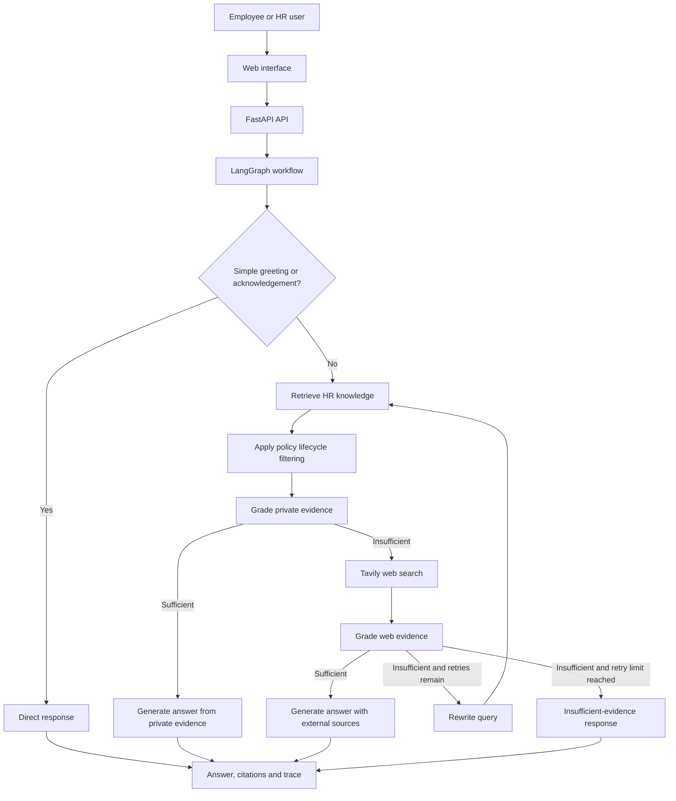

# HR Mind AI

<p align="center">
  <strong>An Agentic RAG HR Knowledge Copilot</strong><br />
  <em>Ground employee answers in trusted HR documents, surface sources, and fall back to public web evidence only when private evidence is insufficient.</em>
</p>

<p align="center">
  <a href="https://hrmindai.dpdns.org/"></a>
  <a href="https://github.com/AshutoshShrivastava28/HR-Mind-AI"></a>
</p>

<p align="center">
  
  
  
  
  
  
</p>

---

## Contents

- [Overview](#overview)
- [Live application](#live-application)
- [Features](#features)
- [How it works](#how-it-works)
- [Technology stack](#technology-stack)
- [Project structure](#project-structure)
- [Getting started locally](#getting-started-locally)
- [Run with Docker](#run-with-docker)
- [Tests](#tests)
- [Production deployment](#production-deployment)
- [Gmail API and secret handling](#gmail-api-and-secret-handling)
- [Demo walkthrough](#demo-walkthrough)
- [Limitations and responsible use](#limitations-and-responsible-use)
- [License](#license)

## Overview

HR teams distribute leave rules, remote-work policies, benefits, payroll guidance, onboarding material, conduct policies, and operational procedures across documents. Employees may struggle to find the right provision, while a general-purpose chatbot can confidently produce answers that are not supported by company policy.

**HR Mind AI** is a conversational assistant built around Retrieval-Augmented Generation (RAG). It prioritizes an organisation's private HR knowledge base, evaluates whether retrieved evidence is sufficient, and can use public web search as a fallback. Answers can be presented with source citations and a trace of the workflow decisions that led to the response.

The project also includes an administrator-facing document workspace, policy lifecycle and version metadata, a public product showcase, account/email workflows, and an Answer Quality dashboard built from application audit events and user feedback.

> **Portfolio-project notice:** AI output can be incomplete or incorrect. Verify important policy decisions against the original document and an authorised HR representative. Do not upload confidential employee records or sensitive company information unless you have permission and the service is approved for that use.

## Live application

| Area | Link | Access |
|---|---|---|
| HR Mind AI app | [hrmindai.dpdns.org](https://hrmindai.dpdns.org/) | Application entry point |
| Public showcase | [Open showcase](https://hrmindai.dpdns.org/showcase) | Public-facing product overview / demo |
| Document management | [Open documents](https://hrmindai.dpdns.org/documents) | Sign in; administrative actions require appropriate permissions |
| Answer Quality dashboard | [Open dashboard](https://hrmindai.dpdns.org/quality) | Sign in; analytics API is administrator-protected |
| Privacy policy | [Read privacy policy](https://hrmindai.dpdns.org/privacy) | Public |
| Terms of service | [Read terms](https://hrmindai.dpdns.org/terms) | Public |
| Source code | [GitHub repository](https://github.com/AshutoshShrivastava28/HR-Mind-AI) | Public repository |

The live deployment runs on a DigitalOcean Droplet. Docker hosts the application, while Caddy terminates HTTPS and reverse-proxies requests to the application container. Application databases, uploaded files, and Gmail OAuth credentials are stored on persistent server mounts rather than being treated as disposable container data.

## Features

### 1. Policy-aware Agentic RAG

- **Private knowledge first:** retrieve company and, where applicable, user-specific documents before considering public web information.
- **Evidence grading:** evaluate whether retrieved passages are sufficient to support an answer.
- **Conditional workflow:** coordinate retrieval, evidence grading, web fallback, query rewriting, and answer generation through LangGraph.
- **Web fallback:** use Tavily when private evidence is weak or insufficient.
- **Bounded retry path:** rewrite a query and retry within the configured retry limit when the workflow calls for it.
- **Insufficient-evidence response:** avoid presenting an unsupported answer as established company policy when available evidence is inadequate.
- **Visible sources and trace:** show citations and useful workflow steps so users can inspect where an answer came from.

### 2. Policy lifecycle and version awareness

- Store policy metadata such as policy family, version label, status, effective date, and superseded-version relationship.
- Support the lifecycle states **Draft**, **Active**, and **Superseded**.
- Filter draft or superseded company-policy chunks from normal retrieval as appropriate to the lifecycle rules.
- Identify potential ambiguity when more than one active version exists in a policy family.
- Re-index affected documents when policy lifecycle metadata changes.

These controls help the retrieval workflow prefer current, approved material. They do not replace HR review of policy wording, applicability, or effective dates.

### 3. Document management

- Upload HR knowledge documents in supported formats, including PDF, TXT, Markdown, and DOCX.
- Extract document text and split it into searchable chunks.
- Generate embeddings with FastEmbed and store vectors in Pinecone.
- Manage company and user-specific documents according to the application's access rules.
- Re-index documents and update policy metadata through the relevant workspace flows.
- Support document removal and vector cleanup through the document APIs.

### 4. Answer Quality dashboard

The `/quality` workspace presents aggregate quality and usage signals from the application's audit events. Depending on the data available, these include:

- Recorded answers and source usage.
- Citation counts and source-engagement events.
- Knowledge-base and web-evidence grading outcomes.
- HR topic coverage and evidence-gap signals.
- Submitted helpfulness feedback and feedback reasons.

The dashboard is designed to report recorded behavior rather than manufacture ratings. **Citation presence is not the same as citation correctness**, and missing feedback means answer helpfulness has not yet been rated by a user. Empty panels are a data-availability state, not proof that the system is performing well or poorly.

### 5. Accounts, access, and email

- User registration and sign-in.
- Email verification and resend-verification flow.
- Forgot-password and password-reset workflow.
- Rate limiting on authentication endpoints.
- Guest mode for public-web questions; guest conversations are not saved to a signed-in user's conversation history.
- Gmail API over HTTPS for transactional email, with optional SMTP fallback when configured.
- Administrator-specific APIs for privileged document and dashboard actions.

### 6. Product and user experience

- Public product showcase at `/showcase`.
- Dedicated document management workspace at `/documents`.
- Answer Quality dashboard at `/quality`.
- Conversation history for signed-in users.
- Source/citation interaction tracking for the quality dashboard.
- Public privacy policy, terms of service, and read-only shared-conversation page support where a valid share link is available.

## How it works


### Request and retrieval flow



The lightweight routing step avoids an extra LLM call for common greetings and acknowledgements. HR and other substantive questions proceed through knowledge retrieval. GPT-OSS 120B, served through Groq, is the configured model for the LLM workflow.

### Production request path

```text
Browser
  │ HTTPS
  ▼
Caddy reverse proxy / TLS
  │
  ▼
HR Mind AI Docker container
  ├── FastAPI application and LangGraph workflow
  ├── Groq — GPT-OSS 120B
  ├── Pinecone — searchable document vectors
  ├── Tavily — public web-search fallback
  ├── Persistent application data and uploads
  └── Gmail API — verification and password-reset email
```

## Technology stack

| Layer | Technology | Purpose |
|---|---|---|
| Language | Python 3.12 | Backend and workflow implementation |
| API framework | FastAPI | HTTP routes, streaming chat, and application services |
| Agent orchestration | LangGraph | Stateful workflow and conditional transitions |
| LLM | Groq `openai/gpt-oss-120b` | Routing-related generation, evidence grading, query rewriting, and answers |
| Embeddings | FastEmbed `all-MiniLM-L6-v2` | Local embedding generation for retrieval |
| Vector database | Pinecone | Semantic search over HR document chunks |
| Web search | Tavily | External fallback when private evidence is insufficient |
| Data storage | SQLite | Account, conversation, and audit/quality records |
| Frontend | HTML, CSS, JavaScript | Chat, document workspace, authentication, and dashboard UI |
| Email | Gmail API; optional SMTP fallback | Verification and password-reset email delivery |
| Containerization | Docker | Reproducible runtime environment |
| Reverse proxy | Caddy | HTTPS termination and request proxying |
| Hosting | DigitalOcean Droplet | Live application hosting |
| Testing | pytest | Unit and API-level regression tests |

## Project structure

```text
HR-Mind-AI/
├── app/
│   ├── api/
│   │   ├── routes.py                 # Chat, document, and quality APIs
│   │   └── auth_routes.py            # Registration, login, verification, password reset
│   ├── core/
│   │   ├── config.py                 # Environment-backed settings
│   │   └── logging.py                # Logging configuration
│   ├── rag/
│   │   ├── policy_lifecycle.py       # Policy status/version filtering
│   │   ├── state.py                  # LangGraph state and grading schemas
│   │   ├── vectorstore.py            # Pinecone retrieval and vector operations
│   │   └── workflow.py               # RAG and web-fallback workflow
│   ├── services/
│   │   ├── authentication.py         # Account, session, and document metadata helpers
│   │   ├── audit.py                  # Audit events, answer feedback, quality aggregates
│   │   ├── email_sender.py           # Gmail API / SMTP delivery
│   │   ├── ingestion.py              # Document extraction and chunking
│   │   ├── rate_limiter.py           # Request rate limiting
│   │   └── upload_validation.py      # Upload validation
│   └── main.py                       # FastAPI app and HTML page routes
├── docs/
│   └── Architecture.png              # Architecture diagram
├── static/
│   ├── css/
│   │   ├── style.css                 # Shared application styling
│   │   └── quality.css               # Answer Quality dashboard styling
│   └── js/
│       ├── app.js                    # Chat and conversation interface
│       ├── auth.js                   # Authentication interface
│       ├── documents.js              # Document workspace interactions
│       └── quality.js                # Dashboard and feedback interactions
├── templates/
│   ├── index.html                    # Main application
│   ├── documents.html                # Document management workspace
│   └── quality.html                  # Answer Quality dashboard
├── tests/
│   ├── test_answer_quality.py
│   ├── test_auth_security.py
│   ├── test_deletion_edge_cases.py
│   ├── test_document_routes.py
│   ├── test_policy_lifecycle_retrieval.py
│   └── test_upload_validation.py
├── data/                             # Local/runtime data; do not commit secrets or production data
├── uploads/                          # Uploaded documents; do not commit private documents
├── Dockerfile
├── requirements.txt
├── ingest_sample_kb.py
├── run.py
└── README.md
```

> The tree lists key project files. Additional templates and support modules may exist in the repository.

## Getting started locally

### Prerequisites

- Python 3.12
- Groq API access for LLM-backed requests
- Pinecone API access and an index configured for the selected embedding model
- Tavily API access for web fallback
- Docker Desktop (optional, for a containerized local run)

### 1. Clone the repository

```bash
git clone https://github.com/AshutoshShrivastava28/HR-Mind-AI.git
cd HR-Mind-AI
```

### 2. Create a virtual environment

**Windows PowerShell**

```powershell
python -m venv .venv
.\.venv\Scripts\Activate.ps1
```

**macOS / Linux**

```bash
python3 -m venv .venv
source .venv/bin/activate
```

### 3. Install dependencies

```bash
python -m pip install --upgrade pip
python -m pip install -r requirements.txt
```

### 4. Configure environment variables

Create a local `.env` file in the repository root. Keep it out of Git. Replace the placeholders with your own credentials and use a long, unique administrative secret.

```env
# AI and retrieval providers
GROQ_API_KEY=replace_with_your_groq_api_key
TAVILY_API_KEY=replace_with_your_tavily_api_key
PINECONE_API_KEY=replace_with_your_pinecone_api_key
PINECONE_INDEX_NAME=fde-hr-policy-rag
PINECONE_NAMESPACE=company-hr-kb
EMBEDDING_MODEL=all-minilm-l6-v2
TOP_K=4
MAX_RETRIES=1

# Application and authentication
APP_ENV=development
ADMIN_EMAIL=admin@example.com
ADMIN_API_KEY=replace_with_a_long_random_secret
PUBLIC_BASE_URL=http://127.0.0.1:8000

# Optional SMTP fallback
SMTP_HOST=
SMTP_PORT=587
SMTP_USERNAME=
SMTP_PASSWORD=
SMTP_FROM_EMAIL=
SMTP_USE_TLS=true
```

Configuration is loaded through `app/core/config.py`. Align the Pinecone index, namespace, and embedding model with the index used during document ingestion. If Gmail API email is being tested locally, configure OAuth credentials through the app's supported configuration path; do not copy production OAuth credentials into the repository.

### 5. Ingest sample HR documents (optional)

After configuring the provider keys and Pinecone index, run this only if you intend to populate or update that index:

```bash
python ingest_sample_kb.py
```

### 6. Start the application

```bash
python run.py
```

Open [http://127.0.0.1:8000](http://127.0.0.1:8000). The application uses configured provider credentials for LLM generation, semantic retrieval, and web fallback. If the interactive FastAPI documentation is enabled in your local environment, it is available at `/docs`.

## Run with Docker

### Build

```bash
docker build -t hr-mind-ai:local .
```

### Run locally

Create and configure `.env` first. The following command creates named volumes for persistent local data and uploads:

```bash
docker run -d \
  --name hr-mind-ai-local \
  --restart unless-stopped \
  -p 8000:10000 \
  --env-file .env \
  -v hr-mind-ai-local-data:/app/data \
  -v hr-mind-ai-local-uploads:/app/uploads \
  hr-mind-ai:local
```

Open [http://127.0.0.1:8000](http://127.0.0.1:8000).

```bash
# Follow logs
docker logs -f hr-mind-ai-local

# Stop the local container
docker stop hr-mind-ai-local
```

The application listens on port `10000` inside the container; port `8000` is published on the host. Named volumes keep `/app/data` and `/app/uploads` across container recreation.

## Tests

The test suite covers answer-quality event handling, authentication/security, document-route access and deletion cases, policy lifecycle retrieval, and upload validation.

Activate your virtual environment, then run:

```bash
python -m pytest -q
```

The full suite passed **36 tests** during validation of the current application changes. The Starlette test client may emit a deprecation warning; a warning is not a test failure.

## Production deployment

The live application is hosted on a DigitalOcean Droplet, with Caddy handling HTTPS for `hrmindai.dpdns.org` and reverse-proxying to the Docker container. The app listens internally on port `10000`.

**Pushing to GitHub does not, by itself, update the live Docker container.** Deploy an intentional, reviewed release and validate it before replacing the running container.

### Production deployment checklist

1. Run the full test suite locally.
2. Commit and push the reviewed source to GitHub.
3. Build the Docker image from the intended commit.
4. Preserve the existing environment and persistent mounts.
5. Keep databases, uploaded HR documents, and OAuth credentials outside the disposable container layer and version control.
6. Run local health checks before switching traffic.
7. Confirm HTTPS, sign-in, registration, verification, password reset, document management, chat, citations, and the Answer Quality dashboard.
8. Retain the previous container/image until the new release passes smoke tests.

The live deployment uses persistent storage for application databases and uploaded documents. The Gmail OAuth credential file is stored separately on the server and mounted into the container at `/app/data/gmail_oauth.json`. Do not delete or overwrite these persistent files during deployment.

## Gmail API and secret handling

The production application uses the Gmail API over HTTPS for transactional messages such as email verification and password reset. SMTP remains available as an optional fallback when configured.

The server-side Gmail OAuth file has this general structure:

```json
{
  "client_id": "YOUR_OAUTH_CLIENT_ID",
  "client_secret": "YOUR_OAUTH_CLIENT_SECRET",
  "refresh_token": "YOUR_REFRESH_TOKEN",
  "sender_email": "authorized-sender@example.com"
}
```

These are placeholder field names, not working credentials. Never commit API keys, OAuth secrets, refresh tokens, passwords, `.env` files, production databases, or private uploads. Restrict permissions on server-side credentials. OAuth tokens can be revoked or invalidated; monitor transactional email delivery and re-authorize when needed.

## Demo walkthrough

A concise end-to-end demonstration can follow this sequence:

1. **Explore the showcase:** open `/showcase` to introduce the product and its workflow.
2. **Sign in:** demonstrate account access and the main conversational interface.
3. **Manage knowledge:** in `/documents`, upload a non-sensitive sample HR policy and inspect its document metadata.
4. **Demonstrate policy lifecycle:** show policy family, version, effective date, status, and supersession metadata where configured.
5. **Ask a policy question:** ask about leave, remote work, benefits, or another topic represented in the uploaded sample documents. Inspect the answer's citations and workflow trace.
6. **Test insufficient evidence:** ask a question not answered by the private policy material and demonstrate the configured fallback or insufficient-evidence response.
7. **Submit feedback and open a source:** demonstrate the real feedback/source-engagement events used by the quality dashboard.
8. **Review quality signals:** open `/quality` with an administrator account and explain the difference between answer counts, citation presence, evidence grading, and user ratings.
9. **Show account recovery:** if email delivery is configured in the demo environment, demonstrate verification or password reset.

Use non-sensitive sample documents and avoid recording real employee information, credentials, email addresses, or private policy material.

## Limitations and responsible use

- LLM responses can be incorrect even when sources are shown. Review important answers against the original policy.
- Public web results are not company policy. Apply them only after verifying applicability with an authorised HR representative.
- Citation presence and source clicks are usage signals; they do not by themselves prove citation correctness or factual grounding.
- The Answer Quality dashboard reflects recorded system events and submitted feedback. Unrated responses should not be treated as positively or negatively reviewed.
- Groq rate limits and API availability can affect LLM-backed requests. The application handles provider errors, but provider quota availability remains external to the project.
- This is a portfolio project and should not be treated as a certified HR, legal, payroll, or compliance system.

## License

This project is distributed under the Apache License 2.0. See [`LICENSE`](LICENSE) for details.
